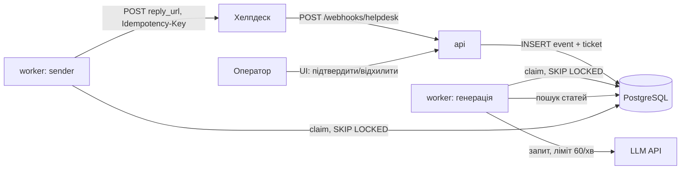

# Архітектура

## Потік

## Статуси звернення
`new` -> `generating` -> `draft_ready` -> `approved` -> `sent`
Збої: `generating` -> `new` (повтор) або `failed` (5 спроб); `approved` -> `failed` (8 спроб відправки або 4xx).
Оператор: `draft_ready` -> `rejected`.

## Таблиці
- `webhook_events(event_id PK)`: дедуплікація подій
- `tickets(ticket_id UNIQUE, status, attempts, locked_until)`: звернення і lease
- `articles(slug UNIQUE, title, body, tsv)`: база знань, GIN-індекс по `tsv`
- `drafts`: чернетки (`article_ids`, `is_mock`)
- `outbound_replies(ticket_id UNIQUE, status, attempts, next_attempt_at)`: черга відправки
- `rate_limit(window_start PK, count)`: лічильник LLM-запитів по хвилинах

## Ключові механізми
- **Швидкий вебхук:** подія й звернення пишуться в одній транзакції, відповідь `202` (новий) або `200` (дублікат). Одночасні дублі відсікає PK.
- **Lease:** `claim` ставить `locked_until`/`next_attempt_at` у майбутнє. Якщо процес помер, запис підхоплюється після спливу lease.
- **Ліміт LLM:** `INSERT ... ON CONFLICT DO UPDATE ... WHERE count < 60` атомарно займає слот хвилини, тож ліміт спільний для всіх потоків і воркерів.
- **Відправка:** успіх лише `201`; 5xx, таймаут і мережеві помилки повторюються з паузою 5, 10, 20, 40 с (максимум 300 с), 4xx (крім 408/429) одразу `failed`.